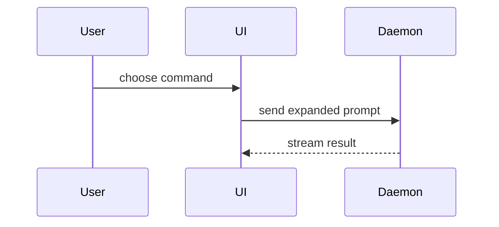

Use this template for writing the PR body:

```markdown
## 👋 For Human

<optional: only what needs a person>

## 💥 Merge Danger

**Door:** <one-way or two-way>

<optional: description>

**Blast Radius:** <one-word description>

<optional: potential ramifications of merge>

**Accepted risks:** <optional: what the merge knowingly carries, and who accepted it>

## 📝 Summary

<diagram, diff-sketch, or tree>

## 🧪 Evidence

- **Before:** <screenshot/output/failing test run>
  **After:** <screenshot/output/passing test run>

## 🔍 Verification

<optional: collapsed groups of steps>

## 🔒 Closes

<optional: the issues this PR closes>
```

## Sections

Skip all preambles and keep prose brief. Use the user's domain language from `GLOSSARY.md`. Emoji go on the section headings only. Leave out an optional section that has nothing in it. Other skills fill these sections; they never add their own.

### For Human

At the top, so a reader knows in one line whether they are needed. Only these, each left out when empty:

- **Needs decision:** a choice only the business or the user can make: a fix that would change behaviour the spec or ticket did not decide (copy, pricing, policy, legal wording), or a cause in data rather than code.
- **Check by eye:** what an agent cannot judge: look and feel, brand tone, a real device, a third-party tool such as Google's Rich Results Test.
- **Not verified:** what nobody could check, and why.
- **Decisions for review:** each choice an agent made for the user during an AFK run, with its reason.
- **Before testing:** the one-line setup a tester needs.

When nothing needs a person, write `Nothing needs you right now.`

### Merge Danger

Describe whether it's a one-way or two-way door. You can walk back through two-way doors, but not one-way doors. A PR that is cheap to roll back is lower risk. Changes that involve destructive actions or hard-to-reverse decisions are one-way doors.

The blast radius is the potential impact or scope of the changes introduced by this PR. Consider all possibilities. Examples are layout shift, breakages for consumers, mobile responsiveness, etc.

Accepted risks are known defects or gaps the merge carries on purpose, each with who accepted it (the spec, a ticket, the user).

### Summary

Pick the smallest view that makes the key point clear.

A multi-ticket PR's Summary also holds a **Tickets table**: each ticket by title and link, its state (✅ merged with a link to its Report, 🔄 in progress, ⛔ blocked by which ticket, or not started) and one line on what it delivered.

- Show logic or an algorithm as pseudocode:

```text
on(save)
  if content is unchanged
    return cached result
  write new content
  return fresh result
```

- Show runtime control flow as a call tree:

```text
submitForm
  createSession
    persistPrompt
    launchAgent
  navigateToSession
```

- Show UI structure as a component tree, including state and module boundaries that matter:

```text
<SessionPage> (apps/example/src/routes/session.tsx)
  useSessionEvents()
  <SessionToolbar>
    <RunSkillButton> (packages/ui)
```

- Show file responsibility or a broad refactor as a shallow file tree:

```text
src/
├── commands/       # parses user actions
├── sessions/       # owns session state
└── transport/      # sends API requests
```

- Show component interaction, control flow, or data flow with Mermaid:



- Use `diff` when the point is what changes and the surrounding shape already exists. Match the diff shape to the topic.

For a component change:

```diff
 <SessionPage>
   useSessionEvents()
   <SessionToolbar>
+    <RunSkillButton />
   <SessionTimeline>
+    <SkillResultCard />
```

For a file-layout change:

```diff
 src/
 ├── commands/
+│   └── show-me.ts       # expands the slash command
 ├── sessions/
-└── transport.ts
+└── transport/
+    ├── client.ts
+    └── stream.ts
```

For a call-tree or call-stack change:

```diff
 submitForm
   createSession
     persistPrompt
+    expandSkillMention
     launchAgent
-  navigateToSession
+  navigateToSession
+    subscribeToEvents
```

For a state or control-flow change:

```diff
 on(save)
-  write content
+  if content is unchanged
+    return cached result
+  write new content
+  invalidate cache
```

- Show the whole block when most of it is new, when omitted context would hide ownership or order, or when the user needs a copyable target shape:

```ts
function expandSkill(command: string): string {
  const skillName = command.slice(1);
  return `use the ${skillName} skill`;
}
```

#### Guidance

Place each visual next to the short text it supports. Keep only the calls, files, props, states, and boundaries needed to answer the user's current question or the options to resolve the current discussion point.

You may use one of these, you may use several, it is unlikely you will use all of them. Use your judgement and don't overwhelm the user.

### Evidence

Concrete evidence that the change works. Show a before and after.

Screenshots are S-tier - when the environment is set up for it and the change is visual.

Execution-based evidence is A-tier. Test results, console output. Show the exact test that now fails and passes, using pseudocode.

### Verification

Every behaviour the PR changed, as steps a person or the `aysnc:prove-it` skill can run on the local stack: happy path, failure paths, edge cases and admin flows. Group the steps by area, each group collapsed with its count, one `- [ ]` step per line written as `where → what you should see`:

```markdown
<details><summary><b>Checkout</b> (2)</summary>

- [ ] `/cart` with one item → Pay shows the total with tax
- [ ] Pay with a declined test card → the error names the card, and the cart is kept
</details>
```

On a multi-ticket PR, every item in every Report's Untested becomes a step. Done when each one has its step.

### Closes

A **Spec** line, then a **Tickets** list, one closing keyword per line with the issue's title, so the reader sees what merging closes without opening each link. Name anything that deliberately stays open.

```markdown
Merging closes the spec and every ticket below. #41 stays open for the launch checklist.

**Spec**
- Closes #12 · Guest checkout

**Tickets**
- Closes #15 · Keep the cart when a payment is declined
```
