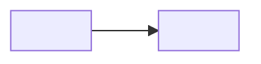

# Code map

Start every task here: find the feature, open its paths, then read the code. The code is the truth; this map only says where to look.

- Words: [GLOSSARY.md](../GLOSSARY.md). Decisions: [docs/adr/](adr/). What users see and how to drive it: the verify skill (`.claude/skills/verify-<app>/`).
- Change this file when a feature is added, removed, renamed or moved. `check-code-map` verifies it.

<!-- Keep the Words/Decisions links only while GLOSSARY.md and docs/adr/ exist: the check fails on a dead link. -->

## Who calls whom

<!--
One node per app, package, datastore and outside system, with real names. Edges point from caller to callee with a short transport label; dotted edges are side paths. Delete what this project doesn't have.
-->

## <Area>

<!--
One "## " area per group of related features; one "### " entry per feature.
A feature is something a user, developer or operator can name and ask to change, with its own place in the code. A smaller part is a keyword of its parent.

Line labels are fixed (the check reads them):
- Keywords: the words people use when asking for a change, including glossary terms.
- Paths: comma-separated, repo-relative start paths; a directory ends with "/". Entry points, not every file.
- Flow: one line, arrows between the steps data or control takes.
- Decisions: links to the ADRs that shape the feature. Omit the line when none do.
Location only: no gotchas, rules, flags, env vars, issue numbers or status. Those belong in code, CODING_STANDARDS.md, ADRs or the tracker.
-->

### <Feature>

Keywords: <word>, <word>
Paths: <path>/, <path>
Flow: <step> → <step> → <step>
Decisions: [0001](adr/0001-<slug>.md)
