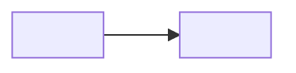

# Feature map

Start every task here: find the feature, open its paths, then read the code. The code is the truth; this map only says where to look.

A feature is anything a user starts from: an import, a config key, a command or a URL. Code with no entry point of its own belongs to the feature it serves.

- Words: [GLOSSARY.md](../GLOSSARY.md). Decisions: [docs/adr/](adr/). Commands that run and drive the app: `AGENTS.md`.
- Change this file when a feature is added, removed, renamed or moved, or its purpose or entry point changes. `check-feature-map` verifies it.

<!-- Keep the Words/Decisions links only while GLOSSARY.md and docs/adr/ exist: the check fails on a dead link. -->

## Who calls whom

<!--
One node per app, package, datastore and outside system, with real names. Edges point from caller to callee with a short transport label; dotted edges are side paths. Delete what this project doesn't have.
-->

## <Area>

<!--
One "## " area per group of related features; one "### " entry per feature.

Line labels are fixed (the check reads them). Each entry holds exactly one Purpose, Entry and Paths line:
- Purpose: one line, what the feature does for its user.
- Entry: where the user starts it: the import, config key, command or URL.
- Paths: comma-separated, repo-relative folders, each ending with "/". Name a single file only when it sits outside its feature's folder.
- Decisions: links to the ADRs that shape the feature. Omit the line when none do.
An entry holds where the feature lives and what it is for. Rules live in code, CODING_STANDARDS.md and ADRs; status lives in the tracker.
-->

### <Feature>

Purpose: <what it does for its user>
Entry: <import, config key, command or URL>
Paths: <path>/, <path>/
Decisions: [0001](adr/0001-<slug>.md)
